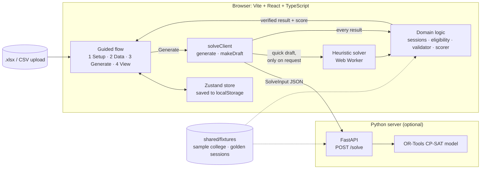

# Architecture

The app runs in the browser. An admin enters the college's week, rooms, teachers, sections and courses, then generates a weekly timetable. A Python server solves the timetable exactly with OR-Tools CP-SAT, or proves that none exists and says why. A heuristic solver in the browser makes a quick draft only when the admin asks for one: when the server is offline, or after the exact solver failed. Either way, a validator in the browser re-checks every result for clashes before the admin sees it.

## How a timetable is generated

1. The store builds a `SolveInput` from the admin's data and any locked cells.
2. Step 3 polls `GET /health` every 5 s. While the server is up, `generate()` posts the input to `/solve` and CP-SAT runs for up to the time limit set in step 3 (20 seconds by default, 120 at most).
3. If CP-SAT proves the input infeasible, the server sends a `diagnosis` (sessions with no slot, invalid locks, or locks that make it impossible). `causes.ts` combines it with the section, teacher and room load checks from step 2 into ranked causes with fix links. Nothing runs in the browser.
4. If CP-SAT runs out of time, the server fails or can't be reached, `generate()` returns a `failure` of that kind and the stored timetable stays.
5. `makeDraft()` runs the heuristic in a Web Worker only when the admin clicks *Make a quick draft* (server offline), *Make a partial timetable* or *Make a quick draft instead*. It returns a partial timetable when needed, with a reason and a cause for each class it could not place, e.g. "no 2 consecutive periods where teacher R. Gupta and Physics Lab are both free".
6. The validator checks the result against the hard rules H1 to H8, and the scorer computes penalties S1 to S4. Both run in the browser, so every engine is judged by the same code.
7. `generateView()` picks what step 3 shows: ready, can't be built, couldn't finish or partial, with a badge such as `✓ Timetable ready · 0 clashes (independently checked)`.

## Shared contract

Both solvers read the same `SolveInput` JSON and return the same `SolveResult` JSON. The types live in `web/src/domain/types.ts`, and `server/models.py` mirrors them. Each course expands into sessions with fixed IDs (`course:L1` for a lecture, `course:P1:B2` for batch 2's first lab). `shared/fixtures/sample-sessions.json` stores the expected expansion of the sample college, and tests on both sides compare against it.

## Code layout

| Path | Contents |
|---|---|
| `web/src/domain/` | Types, session expansion, room eligibility, validator, scorer. Pure functions with tests. |
| `web/src/engine/` | Heuristic solver, its Web Worker, and `solveClient`. |
| `web/src/store/` | Zustand store with localStorage persistence. |
| `web/src/features/` | One folder per step: `setup`, `data`, `generate`, `view`. |
| `server/` | FastAPI app, Pydantic models, session expansion, CP-SAT model. |
| `shared/fixtures/` | Sample college and the golden session list. |

## Features

### Step 1: Setup week

| Feature | What it does | Ticket |
|---|---|---|
| Working days | Pick any days from Mon to Sun. | T05 |
| Period grid | Set each period's start, end and type (teaching or break), or generate the grid from a start time, length and count. | T05 |
| Lunch candidates | Mark the periods where lunch may fall. Every section and teacher gets at least one of them free each day. | T05 |

### Step 2: Add data

| Feature | What it does | Ticket |
|---|---|---|
| Sample college | One click loads 3 departments, 9 sections and 25 teachers. | T06 |
| Excel template | Downloads a workbook with Teachers, Rooms, Sections and Courses sheets. | T06 |
| Import with row errors | Uploads the filled workbook and lists problems by row, such as `Courses row 7: teacher "Sharma" not found`. | T06 |
| Edit tables | Add, edit or delete teachers, rooms, sections and courses. | T06 |
| Shared and owned rooms | A room with no department is shared by all departments. An owned room serves only its department. | T01, T06 |
| Lab batches | A section can split into batches. Each batch gets its own lab sessions, and batches can run different labs at the same time. | T01, T06 |
| Capacity check | Warns when a section needs more periods than the week has. | T06 |

### Step 3: Generate

| Feature | What it does | Ticket |
|---|---|---|
| Exact solver (CP-SAT) | Finds the best timetable under the hard rules, or proves none exists and names the cause. The only engine Generate runs. | T04, T16, T18 |
| Quick draft (heuristic) | Places the hardest sessions first, retries with random restarts, then improves the result by moving and swapping sessions. Runs only from a *quick draft* / *partial* button. | T03, T18 |
| Can't be built | Ranked causes with fix links into step 2 or 4, and an opt-in partial timetable. | T17, T18 |
| Couldn't finish | Timeout, server error or unreachable: the timetable stays; try again with more time or make a quick draft. | T18 |
| Offline banner | Polls the server every 5 s; while it is down the main button makes a quick draft. | T18 |
| Unplaced reasons | Lists each session that could not be placed, grouped by the cause that blocked it. | T03, T07, T18 |
| Validator badge | Re-checks every result for clashes: ready, or partial with the count not placed. | T02, T07, T18 |

### Step 4: View and export

| Feature | What it does | Ticket |
|---|---|---|
| Section, teacher and room views | One grid with a switcher. Labs span their periods, subjects have fixed colours, and batch sessions stack in one cell. | T08 |
| Cell details | Hover for a tooltip, click for a panel with subject, section, batch, teacher, room and time. | T08 |
| Quality score | Shows penalties for repeated subjects, teacher overload, section gaps and idle batches. | T09 |
| Teacher load | Periods per week and per day for each teacher, with the highest and lowest highlighted. | T09 |
| Room utilisation | Percentage of slots used per room, with a total for shared rooms. | T09 |
| Lock and regenerate | Lock cells the admin wants to keep, then re-solve everything else. | T10 |
| Print to PDF | A4 landscape print layout for one section or all sections. | T11 |

### Rules the solvers enforce

Hard rules (never broken): no teacher, section or room is double-booked (H1 to H3), rooms match the session type and department (H4), every session is placed once (H5), labs use consecutive teaching periods (H6), nothing goes in a break (H7), and every section and teacher gets a lunch period each day (H8).

Soft rules (penalised in the score): the same subject twice in a day (S1), a teacher teaching more than 3 periods in a row (S2), idle periods in a section's day (S3), and one batch sitting idle while another is in a lab (S4).

### Stretch goals

Drag-and-drop editing with valid slots highlighted (T13) is built: `web/src/features/view/moves.ts` checks every slot for a dragged class against the hard rules and the validator re-checks each drop. Still to do: a Vercel deploy with an optional in-browser glpk.js solver (T14).
