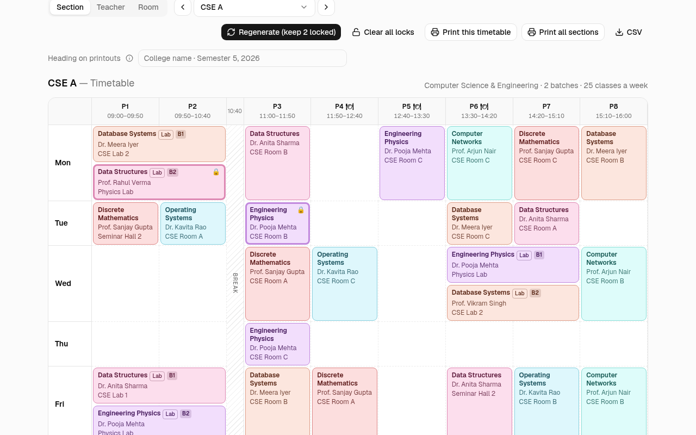
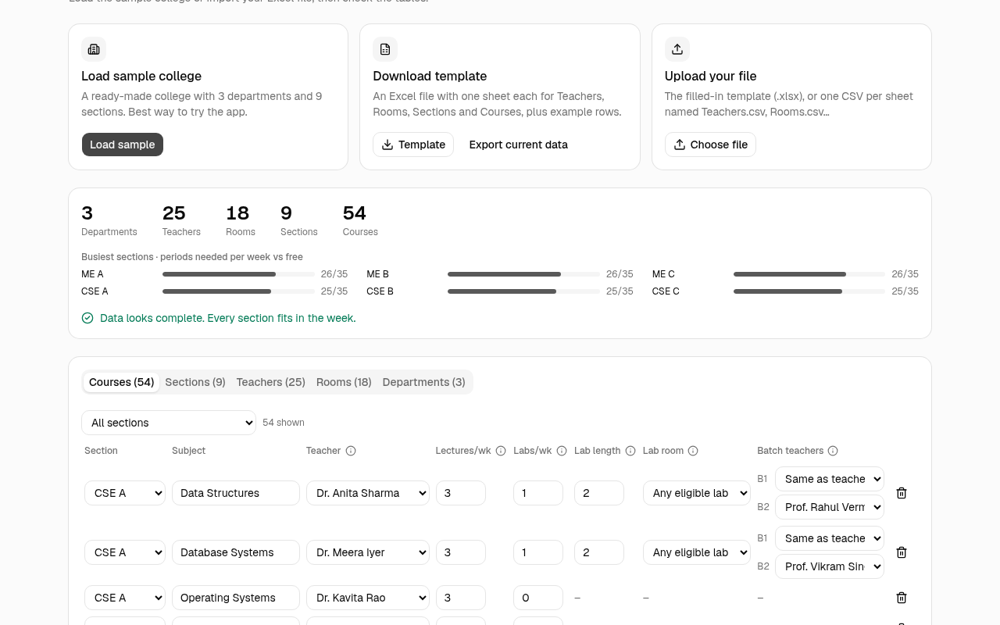
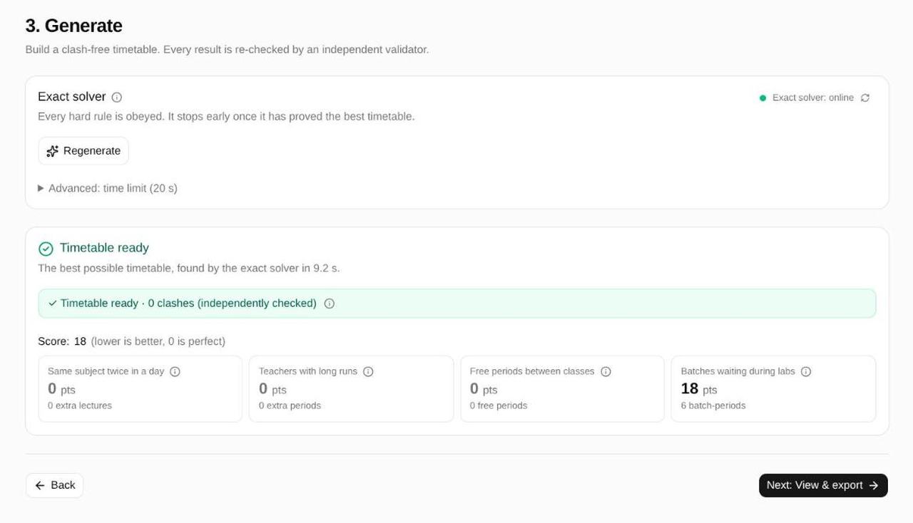
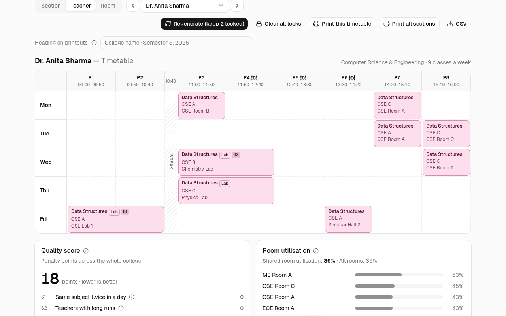
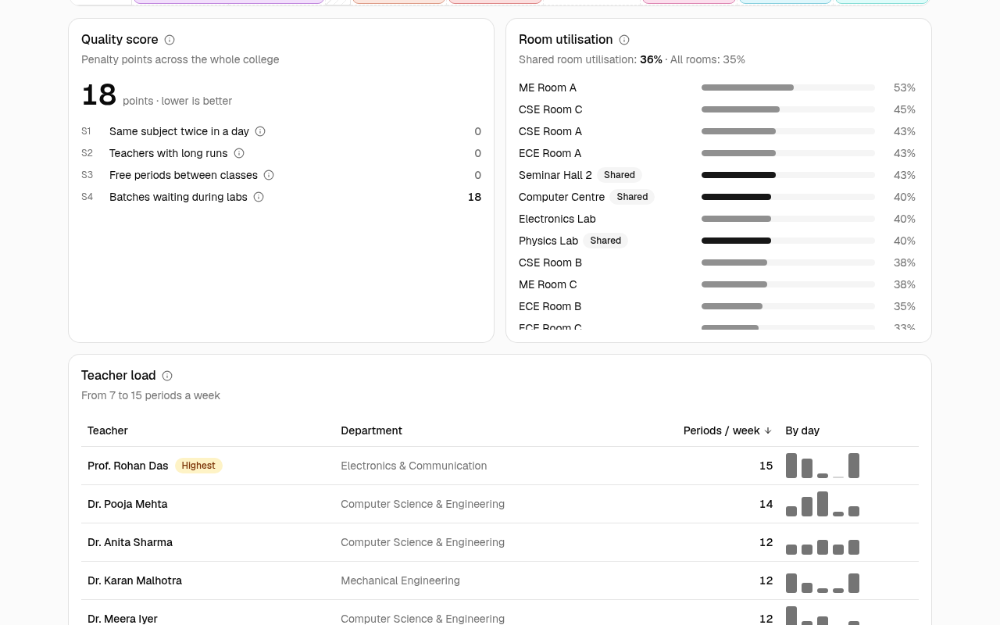
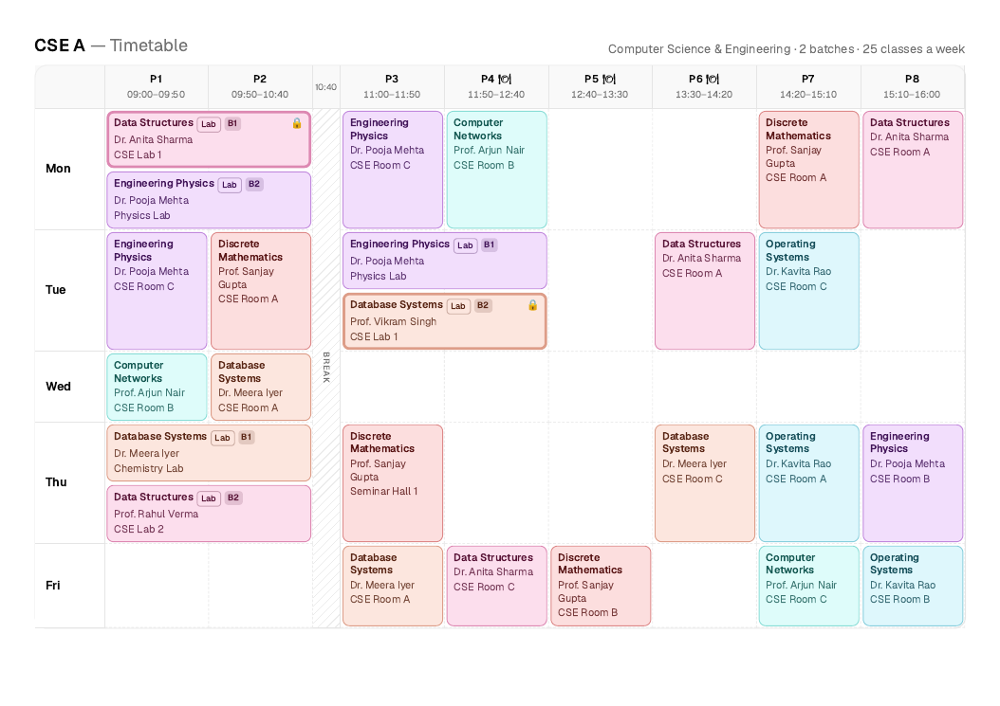

#  Lattice

A college timetable generator. Builds a clash-free weekly class timetable for a whole college in seconds.

Most colleges still build the timetable by hand in a spreadsheet. It takes the coordinator days, and a single
change (a teacher leaves, a lab moves) can cause clashes across a dozen sections. This app takes the college's
bell schedule, rooms, teachers, sections and courses, and generates a timetable where no teacher, section or
room is ever double-booked. Every result is re-checked by an independent validator before the coordinator
sees it.



## Features

- **Any college's week.** Pick the working days, the periods with their times, breaks and lunch periods.
- **Excel in, Excel out.** Download a template, fill it in, upload it. Problems are listed by row
  (`Courses row 7: teacher "Sharma" not found in Teachers sheet`) and nothing is imported until the file is clean. Or start from
  the built-in sample college (3 departments, 9 sections, 25 teachers, 18 rooms, 54 courses).
- **Real-college rules.** Department-owned and shared rooms, labs that run for 2–3 consecutive periods, sections
  split into lab batches that run different labs at the same time, a guaranteed lunch period for everyone.
- **Exact solver first.** An exact optimiser (OR-Tools CP-SAT) in a small Python server finds the best
  timetable or proves none exists. If it can't be built, step ③ says why (an over-booked teacher, a lab
  with no room, a lock in the way…) with a fix link for each cause. A quick draft (a fast heuristic in the
  browser) runs only when you ask for one: when the server is offline, or as a partial timetable.
- **Verified results.** `✓ Timetable ready · 0 clashes (independently checked)`, re-checked in the browser
  whichever engine ran. A partial timetable lists the classes it couldn't place, grouped by cause.
- **Section, teacher and room views** of the same timetable, colour-coded by subject.
- **Quality stats.** Score breakdown, teacher load per day, room utilisation.
- **Lock and regenerate.** Lock the cells you want to keep, re-solve everything else.
- **Drag and drop.** Drag a class to another slot: free slots go green with the score change, the rest red with
  the reason. Every drop is re-validated and locked, with Undo.
- **Print / PDF.** One timetable, or every section on its own A4 page. CSV export of every placement.

Everything is saved in the browser (localStorage). There are no accounts and no database.

| Add data | Generate |
|---|---|
|  |  |
| **Teacher view** | **Stats** |
|  |  |

<details>
<summary>Printed timetable (A4 landscape)</summary>



</details>

## Run it

You need Node 20.19+ (Vite 8) and [uv](https://docs.astral.sh/uv/), which installs Python 3.12+ if it's missing.
Tested with Node 24 and Python 3.12.

```bash
# 1. Web app → http://localhost:5173
cd web && npm install && npm run dev

# 2. Solver server → http://localhost:8000 (without it, step ③ offers a quick draft in the browser)
cd server && uv sync && uv run uvicorn main:app --port 8000
```

Then open the app, go to step **2 Add data → Load sample**, step **3 Generate → Generate timetable**, and
step **4** to browse it.

The web app looks for the server at `http://localhost:8000`; set `VITE_SOLVER_URL` to point it elsewhere.

## How it works

```
 Browser                                                    Python server (optional)
 ┌────────────────────────────────────────────────┐        ┌──────────────────────────┐
 │ 1 Setup → 2 Data → 3 Generate → 4 View/export  │        │ FastAPI  POST /solve     │
 │                        │                       │  JSON  │   └ OR-Tools CP-SAT      │
 │                   solveClient ─────────────────┼───────►│     (exact, optimal)     │
 │                        │ quick draft, only when │        └──────────────────────────┘
 │                        │ you click for one      │
 │                        ▼                        │
 │             heuristic engine (Web Worker)       │
 │                        │                        │
 │      every result ─► validator (H1–H8) + scorer (S1–S4) ─► badge + timetable
 └────────────────────────────────────────────────┘
```

- **CP-SAT** models every hard rule as a constraint and minimises the soft-rule penalties. On the sample
  college it places all 210 sessions and proves the result optimal in about 10 s. When no timetable exists
  it says which sessions have no slot or which locks are to blame; the browser adds section, teacher and room
  load maths and ranks the causes.
- **The heuristic** places the most constrained sessions first, restarts with different random seeds, then
  improves the timetable by moving and swapping sessions. It never creates a clash. On the sample it reaches
  the same score in about 5 s with no server. It runs only when you ask for a quick draft or a partial timetable.
- **The validator and scorer** are plain TypeScript, separate from both engines. They are the source of truth
  for the badge and the score, so the two engines are judged by the same code.

Both engines read and return the same JSON (`SolveInput` / `SolveResult`, defined in
[`web/src/domain/types.ts`](web/src/domain/types.ts) and mirrored in [`server/models.py`](server/models.py)).
See [ARCHITECTURE.md](ARCHITECTURE.md) for the full flow and code layout, and [PLAN.md](PLAN.md) for the design
decisions.

### Rules

Hard rules are never broken. Soft rules add penalty points; lower is better and 0 is perfect.

| | Rule |
|---|---|
| **H1** | A teacher teaches at most one session at a time. |
| **H2** | A section attends at most one session at a time. A whole-section class clashes with every batch; two batch labs clash only if they are the same batch. |
| **H3** | A room hosts at most one session at a time. |
| **H4** | The room fits the session: classroom or lab, shared or owned by the section's department, and the course's required lab if it has one. |
| **H5** | Every session is placed exactly once, or listed as unplaced with a reason. |
| **H6** | A lab takes consecutive teaching periods on one day and never runs across a break. |
| **H7** | Nothing is placed in a break. |
| **H8** | Every section and teacher has at least one lunch-candidate period free every day. |

| | Soft rule | Penalty |
|---|---|---|
| **S1** | The same subject's lecture twice in one day | 10 per extra lecture |
| **S2** | A teacher teaching more than 3 periods in a row | 5 per period beyond 3 |
| **S3** | Free periods between a section's first and last class (lunch periods don't count) | 2 per period |
| **S4** | One batch idle while another batch of the section is in a lab | 3 per idle batch-period |

The sample college scores 18, all from S4: its lab lengths and batch counts make some idle batch periods
unavoidable, and CP-SAT proves nothing better exists.

## Tests

```bash
cd web && npm test && npx tsc -b     # Vitest: domain, engines, import, stats, locks…
cd server && uv run pytest           # Pytest: API, session parity with the web app, CP-SAT model
```

The web and server sides both expand the sample college into sessions and compare against the same golden
file, [`shared/fixtures/sample-sessions.json`](shared/fixtures/sample-sessions.json), so the two solvers can't
drift apart.

## Demo script (90 s)

1. **Setup (5 s).** Step 1 shows the bell schedule: 8 periods, a break, three lunch candidates. *Next.*
2. **Data (10 s).** *Load sample.* "3 departments, 9 sections, 54 courses; every section fits in the week."
3. **Generate (20 s).** Server dot is green. *Generate timetable.* While it runs: "the exact solver is proving
   the best possible timetable." Point at *Timetable ready · best possible*, the
   `✓ Timetable ready · 0 clashes (independently checked)` badge and the score breakdown.
4. **Views (20 s).** *View timetable.* CSE A: labs span two periods, batches B1/B2 run labs side by side.
   Switch to **Teacher**, search "Anita": her whole week. Switch to **Room** and pick Seminar Hall 1:
   one shared hall used by all three departments.
5. **Stats (10 s).** Scroll down: score explained rule by rule, shared room utilisation, teacher load bars.
6. **Lock + regenerate (15 s).** Click a cell → *Lock here*; lock a second one. *Regenerate (keep 2 locked)*.
   The two 🔒 cells stay put, everything else moves, still 0 clashes. Then drag a class: green slots show the
   score change, hover a red one for the reason, drop on green → moved, locked, still `✓ Timetable ready · 0 clashes`.
7. **Print (10 s).** *Print all sections* → one A4 page per section, colours kept.

Backup: stop the server. Within 5 s step ③ shows an amber "Exact solver is offline" banner and the button reads
*Make a quick draft*; the draft still reads 0 clashes. To show *can't be built*, give one course 30 lectures
in step ②: step ③ names the over-booked section and teacher with fix links.

## Project docs

- [PLAN.md](PLAN.md): product decisions, rules, data contract
- [ARCHITECTURE.md](ARCHITECTURE.md): how the pieces fit, code layout, feature list
- [tickets/](tickets/README.md): the work breakdown; [PROGRESS.md](PROGRESS.md): what was built, known issues
