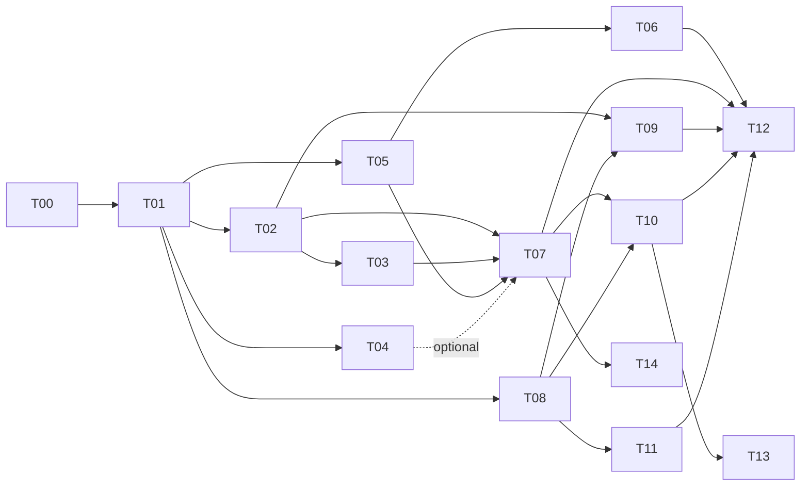

# Tickets

Read [`../PLAN.md`](../PLAN.md) first; it has the data contract and the rules (H1–H8, S1–S4).

**Status lives in each ticket file** (`Status: TODO | IN PROGRESS | DONE`), so parallel branches don't
conflict. A ticket may start only when all its prerequisites are DONE. To see the board:

```bash
grep -H '^\*\*Status' tickets/T*.md
```

| Ticket | Title | Lane | Prereqs | Est. |
|---|---|---|---|---|
| [T00](T00-scaffold.md) | Repo + web + server scaffold | main | — | 8m |
| [T01](T01-domain-contract.md) | Domain types, sessions, sample college, golden file | main | T00 | 10m |
| [T02](T02-validator-scorer.md) | Validator + scorer | C | T01 | 15m |
| [T03](T03-heuristic-engine.md) | Heuristic engine + improvement pass + Web Worker | C | T01, T02 | 35m |
| [T04](T04-cpsat-server.md) | FastAPI + CP-SAT solver | B | T01 | 45m |
| [T05](T05-app-shell-setup.md) | App shell, stepper, store, Step ① Setup | A | T01 | 20m |
| [T06](T06-data-import.md) | Step ② Data: sample, Excel import/template, edit tables | A | T05 | 35m |
| [T07](T07-generate-flow.md) | Step ③ Generate: engine selection, fallback, verify badge | main | T02, T03, T05 (T04 optional) | 15m |
| [T08](T08-timetable-views.md) | Step ④ Timetable grid with Section/Teacher/Room views | D | T01, T05 | 30m |
| [T09](T09-stats-panel.md) | Stats: score breakdown, teacher load, room utilisation | any | T02, T08 | 15m |
| [T10](T10-lock-regenerate.md) | Lock cells + regenerate | any | T07, T08 | 20m |
| [T11](T11-print-export.md) | Print CSS / PDF export | D | T08 | 10m |
| [T12](T12-polish-usertest.md) | Polish, tooltips audit, README, user test | main | T06, T07, T09, T10, T11 | 15m |
| [T13](T13-drag-drop.md) | *Stretch:* drag-and-drop with valid-slot highlighting | any | T10 | — |
| [T14](T14-glpk-deploy.md) | *Stretch:* glpk.js exact engine in browser / Vercel deploy | any | T07 | — |



## Ticket template

```md
# TNN — Title
**Status:** TODO
**Lane:** X · **Prereqs:** … · **Branch:** tNN-…

## Goal
## Scope / files
## Details
## Tests (keep light)
## Done when
- [ ] …
```
