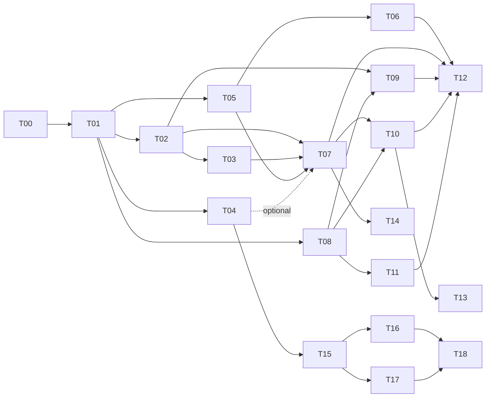

# Tickets

Read [`../PLAN.md`](../PLAN.md) first; it has the data contract and the rules (H1–H8, S1–S4).

## Board: what's done, what's running, what's next

```bash
python3 tickets/board.py          # counts, every open ticket with its state, the next one to take
python3 tickets/board.py --next   # just "T15 t15-contract" (exit 1 if nothing is ready)
```

The board is **computed, never edited**: it reads each ticket's `**Status:**` line from `main`, every local branch
and every worktree (uncommitted edits too), so agents in parallel worktrees see each other without merging. The
newest copy of a ticket wins, except that DONE on `main` is final. States:

| State | Meaning |
|---|---|
| DONE | `Status: DONE` committed on `main` |
| MERGE PENDING | DONE on a branch, not merged into `main` yet; tickets that need it keep waiting |
| IN PROGRESS | a `tNN-…` branch exists (the claim), or the ticket says IN PROGRESS |
| BLOCKED / PARKED | the ticket says so, with a reason |
| READY | TODO and every prereq is DONE on `main` |
| WAITING | TODO with prereqs not DONE on `main` yet |

## Rules for agents

1. **Pick:** run the board and take **Next** (the lowest-numbered READY ticket). Never take BLOCKED, PARKED or
   another agent's IN PROGRESS ticket.
2. **Claim:** `git branch <the ticket's **Branch:** name> main`. Git refuses if the branch already exists, so only
   one agent wins; if it fails, run the board again and take the next ticket. Then work on that branch (or
   `git worktree add ../<repo>-tNN <branch>`), and set `**Status:** IN PROGRESS` in the first commit.
3. **Finish:** set `**Status:** DONE` and tick the checklist in the commit that completes the ticket; it counts as
   done for others once it is merged into `main`.
4. **Stuck:** `**Status:** BLOCKED (reason)`, e.g. `BLOCKED (needs human: user test)`. Shelved on purpose:
   `**Status:** PARKED (reason)`.
5. **Ticket headers** must parse; the board lists any that don't under *Problems*:
   - `# TNN — Title`
   - `**Status:** TODO | IN PROGRESS | BLOCKED (reason) | PARKED (reason) | DONE`
   - `**Lane:** … · **Prereqs:** T01, T02 · **Branch:** tNN-short-name`. Prereqs are whole tickets or `—`;
     put optional or partial dependencies in the ticket text, or split the ticket.

Don't add a hand-written status table here: it would conflict on every parallel branch and go stale.

| Ticket | Title | Lane | Prereqs | Est. |
|---|---|---|---|---|
| [T00](T00-scaffold.md) | Repo + web + server scaffold | main | — | 8m |
| [T01](T01-domain-contract.md) | Domain types, sessions, sample college, golden file | main | T00 | 10m |
| [T02](T02-validator-scorer.md) | Validator + scorer | C | T01 | 15m |
| [T03](T03-heuristic-engine.md) | Heuristic engine + improvement pass + Web Worker | C | T01, T02 | 35m |
| [T04](T04-cpsat-server.md) | FastAPI + CP-SAT solver | B | T01 | 45m |
| [T05](T05-app-shell-setup.md) | App shell, stepper, store, Step ① Setup | A | T01 | 20m |
| [T06](T06-data-import.md) | Step ② Data: sample, Excel import/template, edit tables | A | T05 | 35m |
| [T07](T07-generate-flow.md) | Step ③ Generate: engine selection, fallback, verify badge | main | T02, T03, T05 | 15m |
| [T08](T08-timetable-views.md) | Step ④ Timetable grid with Section/Teacher/Room views | D | T01, T05 | 30m |
| [T09](T09-stats-panel.md) | Stats: score breakdown, teacher load, room utilisation | any | T02, T08 | 15m |
| [T10](T10-lock-regenerate.md) | Lock cells + regenerate | any | T07, T08 | 20m |
| [T11](T11-print-export.md) | Print CSS / PDF export | D | T08 | 10m |
| [T12](T12-polish-usertest.md) | Polish, tooltips audit, README, user test | main | T06, T07, T09, T10, T11 | 15m |
| [T13](T13-drag-drop.md) | *Stretch:* drag-and-drop with valid-slot highlighting | any | T10 | — |
| [T14](T14-glpk-deploy.md) | *Stretch:* glpk.js exact engine in browser / Vercel deploy | any | T07 | — |
| [T15](T15-solve-contract.md) | Solve contract: diagnosis + unplaced cause | main | T04 | — |
| [T16](T16-server-causes.md) | Server infeasibility causes + locks probe | B | T15 | — |
| [T17](T17-client-causes.md) | Room load checks, ranked causes with fixes, teacher filter | A | T15 | — |
| [T18](T18-exact-first-ui.md) | Exact-first Generate UI: impossible / couldn't finish / partial / offline | main | T16, T17 | — |



## Ticket template

```md
# TNN — Title
**Status:** TODO
**Lane:** X · **Prereqs:** — · **Branch:** tNN-…

## Goal
## Scope / files
## Details
## Tests (keep light)
## Done when
- [ ] …
```
